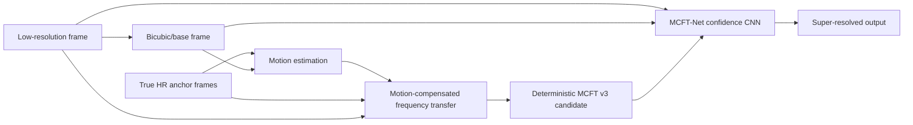

# MCFT: Motion-Compensated Frequency Transfer

MCFT is a sparse-reference video super-resolution project. The input is a
low-resolution video plus a small budget of true high-resolution anchor frames.
The output is a full high-resolution video reconstructed by combining motion
estimation, frequency-band transfer, an LR observation constraint, and a compact
learned refinement network.

The learned stage uses a 173,732-parameter residual CNN on top of deterministic MCFT v3. The
network is intentionally small: it does not replace the MCFT operator with a
large black-box VSR model; it learns how to refine and trust the MCFT proposal.

## Problem Setup

The project uses a sparse-anchor super-resolution protocol:

```text
Input:
  LR video frames
  + sparse true HR anchor frames

Output:
  HR reconstruction for every frame
```

For the REDS benchmark runs in this repository:

```text
scale: x2
degradation: OpenCV bicubic downsample
anchor budget: 10% true HR frames
anchor policy: uniform anchors
primary evaluation split: non-anchor frames
```

Non-anchor frames are the important part of the benchmark. Anchor frames are
copied from true HR by design, so reporting non-anchor averages avoids inflating
the result with frames that are already known.

## Method Overview



The method has two stages:

1. Deterministic MCFT v3 creates a physically motivated HR candidate.
2. MCFT-Net refines that candidate with a lightweight CNN.

The deterministic stage is the important algorithmic core. The CNN is not asked
to hallucinate a full HR image from scratch; it learns to correct a motion and
frequency based proposal.

## Deterministic MCFT v3

For each non-anchor frame, MCFT v3 performs the following steps.

1. **Base construction**

   The default reproducible path upsamples the LR frame with bicubic to create
   an HR-size base. For modern-base experiments, this base can instead come from
   an external SR model such as HAT, SwinIR, Real-ESRGAN, EDVR, or BasicVSR++.
   In that setup MCFT becomes an anchor-aware refinement layer over the modern
   SR prior.

2. **Anchor lookup**

   Nearby true HR anchors are selected from the sparse anchor manifest. REDS
   benchmark clips use uniform 10% anchors; the BBB demo uses adaptive anchors.

3. **Motion estimation**

   Motion is estimated between the current frame and neighboring anchors. The
   main reproducible benchmark path uses OpenCV DIS optical flow. The core
   helper also contains optional RAFT support, but RAFT is not part of the frozen
   best-texture benchmark.

4. **Motion-compensated anchor projection**

   Anchor information is warped toward the target frame using the estimated
   displacement field. Flow confidence reduces reliance on unreliable regions.

5. **Frequency-band transfer**

   MCFT separates luma information into low, mid, and high-frequency structure.
   The base frame supplies stable low-frequency content; warped anchors supply
   high-frequency residual proposals. If a modern base is used, anchor residuals
   are measured relative to that same modern base rather than relative to
   bicubic.

6. **Local phase/refinement**

   The v3 reconstruction includes local phase-style refinement and multiscale
   residual handling to avoid directly pasting mismatched anchor detail.

7. **LR observation constraint**

   The HR estimate is projected back toward the LR observation. If the
   reconstructed HR frame downsampled back to LR does not match the actual LR
   input, the method corrects the HR estimate. This prevents high-frequency
   detail from violating the observed low-resolution frame.

The output of this stage is `mcft_v3.mkv`, the deterministic MCFT candidate.

## MCFT-Net

MCFT-Net is a compact residual CNN implemented in `mcft_net.py`.

Default architecture:

```text
architecture: confidence
width: 32
residual blocks: 6
parameters: 173,732
```

The model receives a multi-channel confidence/refinement tensor built from the
base frame, deterministic MCFT candidate, residual information, LR-consistency
features, and anchor-distance/confidence features. It predicts a
bounded correction around the base/candidate rather than an unconstrained image.

Conceptually:

```text
input = [base frame, MCFT candidate, residual/confidence/anchor features]
output = refined HR frame
```

This makes the method closer to a learned trust/refinement module than a full
standalone VSR model.

Important: a network trained with bicubic-base MCFT inputs should not be assumed
to work on HAT/SwinIR/Real-ESRGAN-base inputs. Modern-base MCFT-Net requires
training or fine-tuning with the same base family used at inference.

## Hugging Face Streaming Data

The project uses Hugging Face as a streaming data source, not as a hosted model
service.

The streaming integration is in:

```text
mcft_hf_stream.py
```

It reads:

```text
bijinc/vimeo-90k-mini
```

through the Hugging Face `datasets` library in streaming mode. The full dataset
is not downloaded into the repository. During training, the script consumes
short Vimeo triplets and constructs synthetic sparse-anchor examples:

```text
frame t-1: endpoint HR anchor
frame t:   target HR frame
frame t+1: endpoint HR anchor
```

The target frame is downsampled to create LR input, then an MCFT-like candidate
is generated from the endpoint anchors. This creates examples of:

```text
LR frame + anchor-derived proposal -> true HR frame
```

An earlier pretraining experiment used mixed replay:

```text
75% REDS replay
25% streamed Vimeo replay
500 streamed Vimeo triplets
```

That experiment is retained for reproducibility, but it is not the final
Real-ESRGAN-backbone checkpoint reported below.

## Training Losses

The texture-aware training recipe fine-tunes MCFT-Net with:

```text
Charbonnier pixel loss
gradient loss
LR observation loss
guard loss against the protected candidate
teacher distillation
Laplacian overshoot penalty
local SSIM loss
temporal residual loss
texture-weighted Laplacian residual loss
L2-SP anchoring to the REDS checkpoint
```

A representative texture-aware run used:

```text
VIMEO_TRIPLETS=500
EPOCHS=1
TEXTURE_WEIGHT=0.03
GRADIENT_WEIGHT=0.20
SHUFFLE_BUFFER=0
```

The texture-frequency term was added after failure analysis showed that the
weakest remaining regions were stochastic fine textures such as asphalt, rather
than anchor transitions or object-boundary failures.

## Historical REDS Budget-Robust Result

An earlier REDS generalization checkpoint is:

```text
mcft_net_reds_budget_robust.pth
```

The weights belong in the Hugging Face repository under
`checkpoints/mcft_net_reds_budget_robust.pth`; they are not committed to Git
because model binaries are generated artifacts.

Its non-anchor results across six REDS validation clips are:

| Clip | PSNR-Y | SSIM-Y | Edge MAE | Temporal MAE |
|---|---:|---:|---:|---:|
| REDS001 | 34.5230 | 0.94952 | 13.098 | 4.1174 |
| REDS006 | 35.8063 | 0.95823 | 11.008 | 3.5774 |
| REDS011 | 29.5159 | 0.92795 | 23.010 | 7.5225 |
| REDS015 | 31.6264 | 0.94099 | 18.191 | 5.9678 |
| REDS017 (held out) | 31.3408 | 0.94429 | 20.577 | 5.7075 |
| REDS018 | 30.1316 | 0.91839 | 24.236 | 7.4961 |
| **Average** | **32.1573** | **0.93990** | **18.353** | **5.7315** |

Only non-anchor rows should be used for claims about reconstruction quality:
anchor frames are true HR observations and therefore inflate full-video scores.
The original REDS run uses the deterministic MCFT candidate as its base. A
separate candidate-diverse run was then trained on bicubic and constrained
candidates, and a backbone-diverse run added Real-ESRGAN candidates. These
results are reported as refinement gains over each candidate, not as a claim
that MCFT replaces the underlying SR backbone.

### Candidate-diverse held-out result

The following averages are over non-anchor frames from held-out REDS clips
002, 003, 004, and 005. The same MCFT harness is applied to each candidate
family at a 10% anchor budget.

| Candidate | PSNR-Y | SSIM-Y | Edge MAE | Temporal MAE |
|---|---:|---:|---:|---:|
| Bicubic | 32.7454 | 0.93668 | 17.3960 | 5.0073 |
| Bicubic + MCFT | **33.8377** | **0.94590** | **14.7507** | **4.3658** |
| Constrained | 33.1863 | 0.94465 | 16.3511 | 4.6212 |
| Constrained + MCFT | **35.8437** | **0.96396** | **11.3853** | **3.4015** |
| Real-ESRGAN | 28.9679 | 0.87655 | 24.4375 | 7.4661 |
| Real-ESRGAN + MCFT | **33.3163** | **0.94514** | **14.9059** | **4.6701** |

The corresponding PSNR gains are +1.09 dB for bicubic, +2.66 dB for the
constrained candidate, and +4.35 dB for Real-ESRGAN. Real-ESRGAN uses a
backbone-adapted MCFT checkpoint; applying the bicubic/constrained checkpoint
without adaptation is intentionally not treated as a valid comparison.

### Real-ESRGAN anchor-budget sweep

On the same four held-out clips, the Real-ESRGAN backbone experiment remains
positive across the tested anchor budgets:

| True-HR anchors | Real-ESRGAN + MCFT PSNR gain | SSIM gain | Edge-MAE change | Temporal-MAE change |
|---:|---:|---:|---:|---:|
| 5% | +4.2514 dB | +0.067014 | -9.3218 | -2.8321 |
| 10% | +4.3484 dB | +0.068599 | -9.5317 | -2.7961 |
| 20% | +4.3588 dB | +0.068288 | -9.4862 | -2.5836 |

### Final loss ablation

The final checkpoint was selected with a fair 5,000-step comparison on the
same backbone-diverse training and validation manifests:

| Recipe | PSNR-Y | SSIM-Y | Edge-MAE | Temporal-MAE |
|---|---:|---:|---:|---:|
| Full control | **33.4222** | 0.946357 | **14.7726** | **4.6024** |
| No temporal loss | 33.3991 | **0.946404** | 14.7957 | 4.6159 |
| No edge/gradient loss | 33.4029 | 0.946314 | 14.7768 | 4.6174 |

The full recipe is retained because it gives the best PSNR, edge fidelity, and
temporal consistency; the SSIM difference is negligible.

### Reproducing the REDS aggregate

After running `evaluate_against_ground_truth.py` for each clip, aggregate the
reports without loading any video into memory:

```bash
python aggregate_reds_quality.py \
  --method budget_robust \
  --input 001=reds_001_generalized_only_quality.csv \
          006=reds_006_generalized_only_quality.csv \
          011=reds_011_generalized_only_quality.csv \
          015=reds_015_generalized_only_quality.csv \
          017=reds_017_generalized_only_quality.csv \
          018=reds_018_generalized_only_quality.csv \
  --output reds_six_clip_generalized_quality.csv
```

Inspect a saved checkpoint without running inference:

```bash
python inspect_mcft_checkpoint.py mcft_net_reds_manifest_joint.pth
```

### True multi-clip training

`mcft_mixed_replay.py` supports a JSON manifest so clips are sampled in one
training run instead of being fine-tuned sequentially. Start from
`reds_multiclip_manifest.example.json`, replace paths as needed, and pass it as
both `--reds-manifest` and `--val-manifest`. Optional `base` fields point to a
modern HR-size base video and must be present during both training and
validation if used.

The benchmark protocol used during development was:

```text
scale: x2
degradation: bicubic downsample
anchor budget: 10% true HR frames
base: deterministic MCFT v3
model: locally trained MCFT-Net confidence checkpoint
inference strength: 1.0
metrics: Y-channel PSNR/SSIM, Edge-MAE, Temporal-delta-MAE
```

Historical BBB/REDS development ablation (not the current generalized
checkpoint):

| Method | PSNR-Y | SSIM-Y | Edge MAE | Temporal MAE |
|---|---:|---:|---:|---:|
| Bicubic | 29.1383 | 0.89470 | 27.105 | 8.1009 |
| Deterministic MCFT v3 | 29.9232 | 0.91142 | 24.967 | 7.2219 |
| MCFT-Net best texture | **30.9367** | **0.92555** | **21.595** | **6.5182** |

Gains over bicubic:

| Metric | Gain |
|---|---:|
| PSNR-Y | +1.798 dB |
| SSIM-Y | +0.03085 |
| Edge MAE | -5.511 |
| Temporal MAE | -1.583 |

Gains over deterministic MCFT v3:

| Metric | Gain |
|---|---:|
| PSNR-Y | +1.014 dB |
| SSIM-Y | +0.01413 |
| Edge MAE | -3.373 |
| Temporal MAE | -0.704 |

The benchmark runner writes generated summaries under:

```text
external_benchmarks/REDS-Val4/mcft_best_texture_summary.csv
external_benchmarks/REDS-Val4/mcft_best_texture_summary.md
```

These files are generated artifacts and are ignored by git.

## External Baseline Comparison Protocol

External comparisons must use the same protocol as MCFT: identical REDS clips,
x2 degradation, resolution, frame count, color conversion, and metric crop.
Because anchors are true HR observations, report non-anchor metrics separately
from full-video metrics. A no-anchor VSR result must not be compared directly
with a 10% anchor result without labeling the protocol.

Use three tracks:

```text
sparse-anchor:  LR + 5/10/20% HR anchors
standard VSR:   LR only, no anchors
modern-base:    external SR base + MCFT refinement
```

For every track, record:

```text
Y-PSNR, Y-SSIM, Edge-MAE, Temporal-delta-MAE,
parameter count, peak memory, and inference time
```

The intended baseline table is:

| Method | Track | Anchors | PSNR-Y | SSIM-Y | Edge-MAE | Temporal-MAE | Params | Runtime |
|---|---|---:|---:|---:|---:|---:|---:|---:|
| Bicubic | sparse-anchor | 10% | — | — | — | — | — | — |
| Deterministic MCFT | sparse-anchor | 10% | — | — | — | — | — | — |
| MCFT-Net | sparse-anchor | 10% | — | — | — | — | — | — |
| EDVR / BasicVSR++ / VRT | standard VSR | 0% | — | — | — | — | — | — |
| HAT or matched modern base | modern-base | 0% | — | — | — | — | — | — |

The external-model rows remain intentionally blank until they are evaluated
under the matched degradation; importing published numbers from different
protocols would not be a fair comparison.

## BBB Demo-Domain Check

The method was also sanity-checked on a five-second Big Buck Bunny demo. In
that domain, MCFT-Net improves deterministic MCFT v3 in PSNR/SSIM, but HAT
remains stronger because it is a large image super-resolution model trained at a
very different scale. Demo videos are generated artifacts and are not committed
to the repository.

## Install

Create an environment with Python 3.9+ and install the core dependencies:

```bash
python -m venv .venv
source .venv/bin/activate
pip install -r scripts/requirements.txt
```

`ffmpeg` is required for video encoding/decoding workflows and should be
installed separately.

## Reproduce The Frozen Benchmark

Train an MCFT-Net checkpoint first, or pass an existing local checkpoint with
`MODEL=/path/to/checkpoint.pth`. Model weights are generated artifacts and are
not committed to this repository.

Run the frozen benchmark on any prepared or fresh REDS validation clip IDs:

```bash
bash scripts/run_mcft_best_texture_benchmark.sh 011 015 018
```

The script prepares missing clips, estimates the degradation model, builds the
MCFT v3 candidate, runs MCFT-Net inference when a model is provided, evaluates
all methods, and writes the aggregate summary.

## Train The Current Recipe

```bash
VIMEO_TRIPLETS=500 \
EPOCHS=1 \
SHUFFLE_BUFFER=0 \
LOG_EVERY=100 \
OUTPUT=mcft_net_confidence_texture.pth \
TEXTURE_WEIGHT=0.03 \
GRADIENT_WEIGHT=0.20 \
bash scripts/run_mcft_mixed_replay.sh
```

For modern-base training, pass HR-size base-prior videos:

```bash
.venv-hat/bin/python mcft_mixed_replay.py \
  --init mcft_net_confidence_reds_best.pth \
  --output mcft_net_confidence_modernbase.pth \
  --reds-gt external_benchmarks/REDS-Val4/train_000_001_gt.mkv \
  --reds-lr external_benchmarks/REDS-Val4/train_000_001_lr.mkv \
  --reds-candidate external_benchmarks/REDS-Val4/train_000_001_mcft_modernbase.mkv \
  --reds-base /path/to/train_modern_sr_base.mkv \
  --reds-anchors external_benchmarks/REDS-Val4/train_000_001_anchors.json \
  --val-gt external_benchmarks/REDS-Val4/006/gt.mkv \
  --val-lr external_benchmarks/REDS-Val4/006/lr_x2.mkv \
  --val-candidate external_benchmarks/REDS-Val4/006/mcft_modernbase.mkv \
  --val-base /path/to/val_modern_sr_base.mkv \
  --val-anchors external_benchmarks/REDS-Val4/006/anchors_10pct.json
```

Hugging Face authentication may be needed depending on dataset access and local
configuration. Do not commit Hugging Face tokens.

## Key Files

| File | Purpose |
|---|---|
| `motion_frequency_transfer.py` | Core motion, warping, confidence, and frequency helpers |
| `mcft_constrained_reconstruct.py` | Deterministic MCFT v3 reconstruction |
| `mcft_net.py` | MCFT-Net CNN architecture, training, and inference |
| `mcft_mixed_replay.py` | REDS/Vimeo mixed replay fine-tuning |
| `mcft_hf_stream.py` | Hugging Face Vimeo-90K streaming integration |
| `prepare_reds_val4.py` | REDS validation clip preparation |
| `estimate_degradation.py` | Degradation-model estimation |
| `evaluate_against_ground_truth.py` | PSNR/SSIM/edge/temporal evaluation |
| `scripts/run_mcft_best_texture_benchmark.sh` | Frozen benchmark runner |
| `scripts/run_bbb_hatbase_experiment.sh` | BBB modern-base experiment runner |
| `summarize_mcft_benchmark.py` | Per-clip to aggregate summary builder |
| `analyze_mcft_failures.py` | Failure-frame ranking and diagnostic panels |

## Artifact Policy

## Final MCFT-Net checkpoint

The final model is `mcft_net_final.pth`, selected using a fair 5,000-step
loss ablation on held-out REDS clips. Under the strict four-clip
uniform-anchor protocol, its non-anchor average is:

| PSNR-Y | SSIM-Y | Edge-MAE | Temporal-delta-MAE |
|---:|---:|---:|---:|
| 33.4222 | 0.946357 | 14.7726 | 4.6024 |

The checkpoint is distributed through the project Hugging Face repository;
the per-clip evaluation CSVs are under `benchmarks/`.

The 12-clip adaptive-anchor extension is reported separately above and should
not be interpreted as a strict uniform-anchor benchmark.

### Model-agnostic backbone result

MCFT is applied after an arbitrary x2 SR backbone: the backbone produces an
HR candidate, and MCFT uses the sparse true-HR anchors plus the LR observation
to make a constrained residual correction. On 12 held-out REDS-style clips,
using Real-ESRGAN as the backbone and evaluating only non-anchor frames:

MCFT is therefore an integration layer or plug-in, not a replacement for the
backbone. The supported deployment pattern is:

```text
LR video -> any x2 SR backbone -> HR candidate
         -> MCFT with sparse HR anchors and LR observation
         -> corrected HR video
```

Real-ESRGAN is the backbone validated in the main model-agnostic experiment.
HAT, EDVR, BasicVSR++, SwinIR, or another x2 SR model can be used as the
candidate generator through the same interface, but the MCFT-Net refinement
checkpoint should be fine-tuned on candidates from that backbone family. A
checkpoint trained on bicubic or Real-ESRGAN candidates must not be assumed to
transfer unchanged to a different backbone.

| Method | PSNR-Y | SSIM-Y | Edge-MAE | Temporal-delta-MAE |
|---|---:|---:|---:|---:|
| Real-ESRGAN | 28.0289 | 0.848617 | 28.4973 | 8.3969 |
| Real-ESRGAN + MCFT | 32.0825 | 0.932485 | 17.9394 | 5.5534 |
| Gain | +4.0536 | +0.083867 | -10.5579 | -2.8435 |

The benchmark reports non-anchor frames separately from the sparse reference
frames; anchor frames are not included in the main averages. The strict
uniform-anchor results are the primary protocol. The current 12-clip extension
contains four clips with uniform anchors and eight clips with offline
content-adaptive anchors selected from the ground truth; it is therefore an
exploratory mixed-protocol generalization result, not a single strict
uniform-anchor aggregate. Per-clip results and the aggregate summary are in
`benchmarks/reds_final_12clip_summary.csv`.

### Reproducibility

Download `checkpoints/mcft_net_final.pth` from the Hugging Face model
repository, prepare an LR video, an HR-size backbone candidate, and an anchor
manifest, then run:

```bash
python mcft_net.py infer \
  --model checkpoints/mcft_net_final.pth \
  --candidate candidate_x2.mkv \
  --low-resolution lr_x2.mkv \
  --base-video bicubic_x2.mkv \
  --anchors anchors_10pct.json \
  --output mcft_output.mkv \
  --tile 256 --overlap 32 --device cuda
```

Evaluation uses `evaluate_against_ground_truth.py`; report the non-anchor row
for the primary comparison.

Generated videos, benchmark folders, model checkpoints, datasets, `.npz`
caches, CSV outputs, plots, local virtual environments, and vendored external
model folders are ignored by git.

Do not commit:

```text
*.mp4, *.mkv
*.pth, *.pt
external_benchmarks/
HAT/
.venv*/
```

Use GitHub Releases, Hugging Face Hub, or project storage for trained
checkpoints and demo videos.

## Scope

This project should not be presented as a direct SOTA replacement for large VSR
models such as BasicVSR++ or EDVR. The defensible claim is narrower and cleaner:

```text
Under a sparse true-HR anchor protocol, deterministic MCFT plus a 0.174M-param
CNN improves over bicubic and deterministic MCFT v3 across fresh REDS-style
clips.
```

Most SOTA tables use different protocols, often canonical REDS4 x4, heavy
training, and no sparse true-HR anchor input. MCFT is best understood as a
sparse-reference reconstruction method with a tiny learned refinement module.
