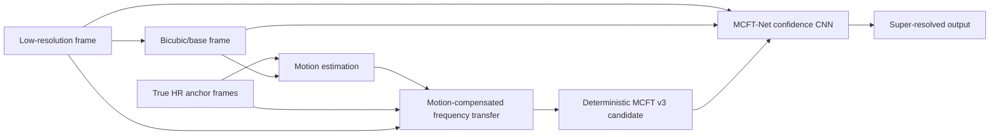

# MCFT: Motion-Compensated Frequency Transfer

MCFT is a sparse-reference video super-resolution project. The input is a
low-resolution video plus a small budget of true high-resolution anchor frames.
The output is a full high-resolution video reconstructed by combining motion
estimation, frequency-band transfer, an LR observation constraint, and a compact
learned refinement network.

The learned stage uses a 173,732-parameter residual CNN on top of deterministic MCFT v3. The
network is intentionally small: it does not replace the MCFT operator with a
large black-box VSR model; it learns how to refine and trust the MCFT proposal.

## Problem Setup

The project uses a sparse-anchor super-resolution protocol:

```text
Input:
  LR video frames
  + sparse true HR anchor frames

Output:
  HR reconstruction for every frame
```

For the REDS benchmark runs in this repository:

```text
scale: x2
degradation: OpenCV bicubic downsample
anchor budget: 10% true HR frames
anchor policy: uniform anchors
primary evaluation split: non-anchor frames
```

Non-anchor frames are the important part of the benchmark. Anchor frames are
copied from true HR by design, so reporting non-anchor averages avoids inflating
the result with frames that are already known.

## Method Overview



The method has two stages:

1. Deterministic MCFT v3 creates a physically motivated HR candidate.
2. MCFT-Net refines that candidate with a lightweight CNN.

The deterministic stage is the important algorithmic core. The CNN is not asked
to hallucinate a full HR image from scratch; it learns to correct a motion and
frequency based proposal.

## Deterministic MCFT v3

For each non-anchor frame, MCFT v3 performs the following steps.

1. **Bicubic base construction**

   The LR frame is bicubic-upsampled to HR size. This gives reliable low
   frequency structure but weak detail.

2. **Anchor lookup**

   Nearby true HR anchors are selected from the sparse anchor manifest. REDS
   benchmark clips use uniform 10% anchors; the BBB demo uses adaptive anchors.

3. **Motion estimation**

   Motion is estimated between the current frame and neighboring anchors. The
   main reproducible benchmark path uses OpenCV DIS optical flow. The core
   helper also contains optional RAFT support, but RAFT is not part of the frozen
   best-texture benchmark.

4. **Motion-compensated anchor projection**

   Anchor information is warped toward the target frame using the estimated
   displacement field. Flow confidence reduces reliance on unreliable regions.

5. **Frequency-band transfer**

   MCFT separates luma information into low, mid, and high-frequency structure.
   The LR/bicubic frame supplies stable low-frequency content; warped anchors
   supply high-frequency residual proposals.

6. **Local phase/refinement**

   The v3 reconstruction includes local phase-style refinement and multiscale
   residual handling to avoid directly pasting mismatched anchor detail.

7. **LR observation constraint**

   The HR estimate is projected back toward the LR observation. If the
   reconstructed HR frame downsampled back to LR does not match the actual LR
   input, the method corrects the HR estimate. This prevents high-frequency
   detail from violating the observed low-resolution frame.

The output of this stage is `mcft_v3.mkv`, the deterministic MCFT candidate.

## MCFT-Net

MCFT-Net is a compact residual CNN implemented in `mcft_net.py`.

Default architecture:

```text
architecture: confidence
width: 32
residual blocks: 6
parameters: 173,732
```

The model receives a multi-channel confidence/refinement tensor built from the
bicubic/base frame, deterministic MCFT candidate, residual information,
LR-consistency features, and anchor-distance/confidence features. It predicts a
bounded correction around the base/candidate rather than an unconstrained image.

Conceptually:

```text
input = [base frame, MCFT candidate, residual/confidence/anchor features]
output = refined HR frame
```

This makes the method closer to a learned trust/refinement module than a full
standalone VSR model.

## Hugging Face Streaming Data

The project uses Hugging Face as a streaming data source, not as a hosted model
service.

The streaming integration is in:

```text
mcft_hf_stream.py
```

It reads:

```text
bijinc/vimeo-90k-mini
```

through the Hugging Face `datasets` library in streaming mode. The full dataset
is not downloaded into the repository. During training, the script consumes
short Vimeo triplets and constructs synthetic sparse-anchor examples:

```text
frame t-1: endpoint HR anchor
frame t:   target HR frame
frame t+1: endpoint HR anchor
```

The target frame is downsampled to create LR input, then an MCFT-like candidate
is generated from the endpoint anchors. This creates examples of:

```text
LR frame + anchor-derived proposal -> true HR frame
```

The final selected model is trained with mixed replay:

```text
75% REDS replay
25% streamed Vimeo replay
500 streamed Vimeo triplets
```

This combination gave better generalization than using either REDS-only or
Vimeo-only adaptation.

## Training Losses

The texture-aware training recipe fine-tunes MCFT-Net with:

```text
Charbonnier pixel loss
gradient loss
LR observation loss
guard loss against the protected candidate
teacher distillation
Laplacian overshoot penalty
local SSIM loss
temporal residual loss
texture-weighted Laplacian residual loss
L2-SP anchoring to the REDS checkpoint
```

A representative texture-aware run used:

```text
VIMEO_TRIPLETS=500
EPOCHS=1
TEXTURE_WEIGHT=0.03
GRADIENT_WEIGHT=0.20
SHUFFLE_BUFFER=0
```

The texture-frequency term was added after failure analysis showed that the
weakest remaining regions were stochastic fine textures such as asphalt, rather
than anchor transitions or object-boundary failures.

## Frozen Benchmark Result

The benchmark protocol used during development was:

```text
scale: x2
degradation: bicubic downsample
anchor budget: 10% true HR frames
base: deterministic MCFT v3
model: locally trained MCFT-Net confidence checkpoint
inference strength: 1.0
metrics: Y-channel PSNR/SSIM, Edge-MAE, Temporal-delta-MAE
```

Expanded frozen multi-clip non-anchor average:

| Method | PSNR-Y | SSIM-Y | Edge MAE | Temporal MAE |
|---|---:|---:|---:|---:|
| Bicubic | 29.1383 | 0.89470 | 27.105 | 8.1009 |
| Deterministic MCFT v3 | 29.9232 | 0.91142 | 24.967 | 7.2219 |
| MCFT-Net best texture | **30.9367** | **0.92555** | **21.595** | **6.5182** |

Gains over bicubic:

| Metric | Gain |
|---|---:|
| PSNR-Y | +1.798 dB |
| SSIM-Y | +0.03085 |
| Edge MAE | -5.511 |
| Temporal MAE | -1.583 |

Gains over deterministic MCFT v3:

| Metric | Gain |
|---|---:|
| PSNR-Y | +1.014 dB |
| SSIM-Y | +0.01413 |
| Edge MAE | -3.373 |
| Temporal MAE | -0.704 |

The benchmark runner writes generated summaries under:

```text
external_benchmarks/REDS-Val4/mcft_best_texture_summary.csv
external_benchmarks/REDS-Val4/mcft_best_texture_summary.md
```

These files are generated artifacts and are ignored by git.

## BBB Demo-Domain Check

The method was also sanity-checked on a five-second Big Buck Bunny demo. In
that domain, MCFT-Net improves deterministic MCFT v3 in PSNR/SSIM, but HAT
remains stronger because it is a large image super-resolution model trained at a
very different scale. Demo videos are generated artifacts and are not committed
to the repository.

## Install

Create an environment with Python 3.9+ and install the core dependencies:

```bash
python -m venv .venv
source .venv/bin/activate
pip install -r scripts/requirements.txt
```

`ffmpeg` is required for video encoding/decoding workflows and should be
installed separately.

## Reproduce The Frozen Benchmark

Train an MCFT-Net checkpoint first, or pass an existing local checkpoint with
`MODEL=/path/to/checkpoint.pth`. Model weights are generated artifacts and are
not committed to this repository.

Run the frozen benchmark on any prepared or fresh REDS validation clip IDs:

```bash
bash scripts/run_mcft_best_texture_benchmark.sh 011 015 018
```

The script prepares missing clips, estimates the degradation model, builds the
MCFT v3 candidate, runs MCFT-Net inference when a model is provided, evaluates
all methods, and writes the aggregate summary.

## Train The Current Recipe

```bash
VIMEO_TRIPLETS=500 \
EPOCHS=1 \
SHUFFLE_BUFFER=0 \
LOG_EVERY=100 \
OUTPUT=mcft_net_confidence_texture.pth \
TEXTURE_WEIGHT=0.03 \
GRADIENT_WEIGHT=0.20 \
bash scripts/run_mcft_mixed_replay.sh
```

Hugging Face authentication may be needed depending on dataset access and local
configuration. Do not commit Hugging Face tokens.

## Key Files

| File | Purpose |
|---|---|
| `motion_frequency_transfer.py` | Core motion, warping, confidence, and frequency helpers |
| `mcft_constrained_reconstruct.py` | Deterministic MCFT v3 reconstruction |
| `mcft_net.py` | MCFT-Net CNN architecture, training, and inference |
| `mcft_mixed_replay.py` | REDS/Vimeo mixed replay fine-tuning |
| `mcft_hf_stream.py` | Hugging Face Vimeo-90K streaming integration |
| `prepare_reds_val4.py` | REDS validation clip preparation |
| `estimate_degradation.py` | Degradation-model estimation |
| `evaluate_against_ground_truth.py` | PSNR/SSIM/edge/temporal evaluation |
| `scripts/run_mcft_best_texture_benchmark.sh` | Frozen benchmark runner |
| `summarize_mcft_benchmark.py` | Per-clip to aggregate summary builder |
| `analyze_mcft_failures.py` | Failure-frame ranking and diagnostic panels |

## Artifact Policy

Generated videos, benchmark folders, model checkpoints, datasets, `.npz`
caches, CSV outputs, plots, local virtual environments, and vendored external
model folders are ignored by git.

Do not commit:

```text
*.mp4, *.mkv
*.pth, *.pt
external_benchmarks/
HAT/
.venv*/
```

Use GitHub Releases, Hugging Face Hub, or project storage for trained
checkpoints and demo videos.

## Scope

This project should not be presented as a direct SOTA replacement for large VSR
models such as BasicVSR++ or EDVR. The defensible claim is narrower and cleaner:

```text
Under a sparse true-HR anchor protocol, deterministic MCFT plus a 0.174M-param
CNN improves over bicubic and deterministic MCFT v3 across fresh REDS-style
clips.
```

Most SOTA tables use different protocols, often canonical REDS4 x4, heavy
training, and no sparse true-HR anchor input. MCFT is best understood as a
sparse-reference reconstruction method with a tiny learned refinement module.
